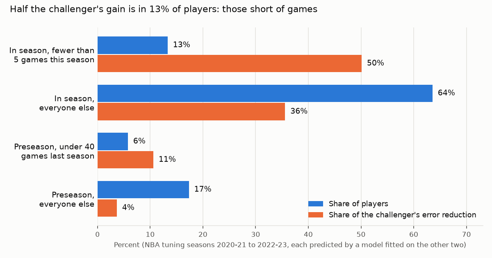

# What the NBA ML challenger learns

Issue #916, following ADR 0030 (#771). Reproduce with:

```
uv run --group benchmark python -m ops.challenger_analysis --setting features-nba.json \
    features-nba-2020-21.csv ... features-nba-2024-25.csv --out challenger-analysis.json
```

The inputs are the `features-nba-<season>` artifacts of export runs 42518215822, 42518217919, 42518220147, 42518222423 and 42518225161. The setting is the one the NBA entered with (`usage_weight` 8, `fg_shrink` 50, `ft_shrink` 25). A run takes about six minutes.

## The short answer

The stacked challenger beats the transparent NBA projection by 5.1% on the judged seasons. Most of that comes from one blind spot in the transparent projection. **Players who have barely played are rated too high.**

In season, a player with fewer than five games this season is projected from his earlier seasons and a replacement-level minutes prior. The projection ignores the minutes he has actually played: the last-games blend and the return ramp both wait for five games. Those players then do about 1.2 value per game worse than projected, whatever their projected level. The challenger learns to mark them down.

One published coefficient for that blind spot recovers about half of the challenger's RMSE gain and two thirds of its ranking gain. That is cross-validated within the tuning seasons, so it is indicative only.

Among the players a fantasy manager actually rosters, the challenger adds almost nothing on the judged seasons: RMSE −0.0004.

**Recommendation: do not adopt the ML model. Judge the short-of-games term, and the usage tilt, on 2026-27 when it completes.**



## How this was measured

- **Tuning seasons only for anything fitted or chosen** (NBA 2020-21 to 2022-23):
  - Each tuning season's challenger values come from the declared model fitted on the other two. That is leave one season out, the same folds its grid was chosen on. The grid point is the declared one: learning rate 0.05, 15 leaves, 20 per leaf, 100 iterations, L2 1; CV RMSE 2.1233, as in ADR 0030.
  - Every importance, partial dependence and term coefficient below comes from those folds.
- **Judged seasons, read only** (2023-24 and 2024-25):
  - These seasons are already spent for the projection's features. The challenger as declared (fitted on all three tuning seasons) and each term at its tuning coefficient are scored there for diagnosis only.
  - Nothing is fitted or chosen on them. The judged gap reproduces ADR 0030: 2.184 → 2.072, −0.112 (−0.140 to −0.083; the published interval is −0.138 to −0.085, the same bootstrap with a different thread count).
- **Locked NBA 2025-26** is refused by the loader, as everywhere.

| | Transparent RMSE | Challenger RMSE | Gap | Spearman | Gap among pool players |
| --- | --- | --- | --- | --- | --- |
| Tuning, leave one season out | 2.2136 | 2.1233 | −0.0903 (−0.1154 to −0.0661) | +0.0180 | −0.0262 |
| Judged, read only | 2.1841 | 2.0722 | −0.1119 (−0.1399 to −0.0826) | +0.0219 | −0.0004 |

"Pool players" are each checkpoint's top players by the transparent value, as many as the league rosters (the scale's pool). They are the players a manager actually decides between.

## Where the gain is

The challenger's squared-error reduction, split by who the player is:

| Segment | Tuning: players | Tuning: share of the gain | Judged: players | Judged: share of the gain | Mean actual minus transparent (tuning / judged) |
| --- | --- | --- | --- | --- | --- |
| In season, fewer than 5 games this season | 13% | **50%** | 14% | **65%** | −1.17 / −1.38 |
| In season, everyone else | 64% | 36% | 63% | 19% | +0.38 / +0.33 |
| Preseason, under 40 games last season | 6% | 11% | 6% | 13% | −0.29 / −0.56 |
| Preseason, everyone else | 17% | 4% | 18% | 2% | −0.09 / +0.03 |
| *Pool players (overlaps the rows above)* | *36%* | *11%* | *35%* | *0%* | *+0.12 / +0.06* |

Players short of games are over-projected by about 1.2 value per game, and the shortfall is roughly the same at every projected level. In an exploratory split of the tuning folds, it runs through every counting category and not the percentages, so it is volume: minutes. Among those still out at the checkpoint, the gaps are points −0.32, steals −0.34, threes −0.24, rebounds −0.24 and turnovers +0.21.

The players short of games split about evenly into those still out at the checkpoint (385) and those who have returned (312). Both groups are over-projected by the same margin: −1.16 and −1.17.

The preseason row is the same effect a season earlier: a player who played under 40 games last season is over-projected.

**The players moved most at a tenth of the season.** Of the 50 players the challenger moves most at each tenth checkpoint:

| Checkpoint | Short of games | Moved down | Closer to what happened | Their share of that checkpoint's gain | Short of games: share of players / of the gain |
| --- | --- | --- | --- | --- | --- |
| 2020-21 @ 0.1 | 74% | 78% | 62% | 58% | 40% / 67% |
| 2021-22 @ 0.1 | 52% | 56% | 72% | 54% | 29% / 74% |
| 2022-23 @ 0.1 | 74% | 78% | 56% | 28% | 30% / 79% |
| 2023-24 @ 0.1 (read only) | 78% | 76% | 86% | 67% | 34% / 80% |
| 2024-25 @ 0.1 (read only) | 62% | 64% | 62% | 50% | 34% / 80% |

The typical case:

- One game played this season, at about 2 minutes, and little or no NBA history.
- The transparent projection gives him about 19 minutes, mostly the replacement-level minutes prior, and a value near −2.
- The challenger reads the 2 minutes and the low games share and moves him to about −5. He then does −5 to −8.

The other big moves are upward: starters already at 32 to 36 minutes this season whose earlier seasons rate them low. Those are the "in season, everyone else" gains.

## What the model uses

**Permutation importance** (sklearn's `permutation_importance` on the value, held-out season, five repeats). The figure is the increase in mean squared error when an input is shuffled, pooled over the 12 held-out checkpoints.

| Inputs shuffled together | MSE increase |
| --- | --- |
| The transparent model's nine scores | 16.33 |
| Minutes (projected, season-weighted, last five, each season's) | 0.284 |
| Earlier seasons' per-minute rates | 0.114 |
| Availability (games share, absence, games since return) | 0.105 |
| This season's per-minute rates | 0.077 |
| Usage and pace | 0.050 |
| Games played in each season | 0.044 |
| New team | 0.023 |

The challenger's gain over the transparent model is 0.39 in MSE, so the transparent scores are its backbone.

The single raw inputs that matter most are games share (0.092), games this season (0.043), this season's minutes (0.032) and the last five games' minutes (0.030). Per category (an exploratory run of the same importance on each category model), the transparent score of that category dominates every model. The next inputs are that category's own per-minute rates this season and last, and games share.

Age plays no part. It is empty in every point-in-time export (#918): the roster rebuilt from games carries no birth dates. So neither model could use it, and an aging term cannot be judged on these exports.

**Partial dependence** (the challenger's value with each input set across its range, transparent scores held as they are, averaged over the folds; relative to the highest point):

| Input | Low end | High end |
| --- | --- | --- |
| Games this season | 2 games: −0.28; 4 games: −0.21 | 6 games or more: −0.02 to 0 |
| Games share | 0.26: −0.47 | 0.85 and above: 0 |
| This season's minutes | 3 min: −0.38 | 30 min and above: 0 |
| Last five games' minutes | 2 min: −0.31 | 38 min: 0 |
| Usage | 0.10: −0.25; flat at −0.18 from 0.12 to 0.20 | 0.31: 0 |

The games-played curve is a step at five games, the gate the projection already uses. That is why the first term below takes the same gate.

## Transparent terms

Each candidate is a published coefficient on the transparent value. It is fitted on two tuning seasons and scored on the third, rotated through the same three folds as the challenger.

**Cross-validated within the tuning seasons, indicative only.** None is shipped. A term enters only once judged on a season neither model has seen, and the next one is 2026-27.

| Term | Coefficient per held-out fold (on all three) | RMSE gap (95% interval) | Share of the challenger's RMSE gain | Spearman gap | Share of its Spearman gain | Pool players | Judged, read only: share of the gain / pool players |
| --- | --- | --- | --- | --- | --- | --- | --- |
| Challenger (reference) | | −0.0903 (−0.1154 to −0.0661) | 100% | +0.0180 | 100% | −0.0262 | 100% / −0.0004 |
| **A. Short of games:** value − b for a player with fewer than five games this season, in season | b 1.1, 1.1, 1.2 (1.2) | −0.0410 (−0.0526 to −0.0286) | **45%** | +0.0116 | **65%** | −0.0046 | 55% / +0.0017 |
| A in the minutes instead: before five games, the last games' minutes enter in proportion to the games (`early` 1); the minutes prior × f | f 0.8, 0.8, 0.7 (0.8) | −0.0389 (−0.0509 to −0.0271) | 43% | +0.0130 | 72% | +0.0008 | 54% / −0.0075 |
| **B. Usage tilt:** value + u per 0.10 of production-weighted usage above 0.20 | u 0.4, 0.4, 0.3 (0.3) | −0.0076 (−0.0138 to −0.0016) | 8% | +0.0012 | 7% | **−0.0298** | 7% / **−0.0131** |
| A and B together | b 1.0, 1.1, 1.2; u 0.3, 0.2, 0.1 (b 1.1, u 0.2) | −0.0414 (−0.0539 to −0.0282) | 46% | +0.0121 | 67% | −0.0223 | 55% / −0.0103 |

Readings:

- **Term A carries the bulk.** One coefficient, stable across the folds (1.1 to 1.2), gets 45% of the RMSE gain and 65% of the ranking gain. On the spent judged seasons it gets 55% (read only).
  - Its minutes form fixes the cause instead of the value. Before five games it reads the minutes a player has actually played, and it trusts the replacement-level minutes prior less.
  - The minutes form recovers about as much: 43% of the RMSE gain and 72% of the Spearman gain. It keeps the projection a per-category line, so punt builds stay exact.
  - The minutes form is the one to judge.
- **Term B is the one that matters for the rosterable players.**
  - High-usage players are under-projected even with `usage_weight` 8 in. Among pool players, the tilt alone cuts RMSE more than the challenger does: −0.030 against −0.026 on tuning, and −0.013 against −0.0004 on the judged seasons, read only.
  - Pooled over everyone, it adds little.
  - It is a level effect, so it is separate from the usage weight, which is about this season against earlier ones.
- **Tried and dropped**, with the same folds and rule (exploratory runs, not in the module):
  - A missed share of team games: 6%.
  - A larger weight on the current season's minutes: 17% alone, nothing once A is in.
  - A cut to minutes in proportion: 35%, a coefficient of 0.15. The shortfall is level, not proportional.
  - Durability in the per-game value: 7%, nothing on top of A.
  - A shrink of below-replacement values: monotone, so it moves no ranking.
  - A linear recalibration of the transparent value took only −0.014 of the judged gap (ADR 0030). The gain is ranking information, not calibration.

## What the rest is

About half of the challenger's RMSE gain is left after term A, and a third of its ranking gain. It lives in three places:

- **Players outside the pool.** On the judged seasons, the challenger's gain among pool players is nil. Its RMSE advantage is in players a manager does not roster: the fringe who have barely played, and the bottom of the board.
- **Starters whose current season outruns their history.** At a tenth of the season, some regulars at 32 to 36 minutes are moved up by about 3. They are part of the "in season, everyone else" share: 36% tuning, 19% judged. The model weighs this season's rates and minutes against a low games share and earlier seasons. No single term captured it: a larger current-season minutes weight got 17% alone and nothing once A was in.
- **The preseason fringe.** Players with under 40 games last season are 11 to 13% of the gain.

## Recommendation

**Do not adopt the ML model.**

- **What one term recovers.** One transparent term, a player short of games, recovers 45% of the challenger's RMSE gain and two thirds of its ranking gain (cross-validated within the tuning seasons, indicative only).
- **The ML model adds nothing where it matters.** Among the players a manager rosters, the challenger's judged gain is nil (−0.0004). The usage tilt does better there than the challenger does.
- **The trade-off.** The rest of the challenger's advantage is interactions among minutes, games share and this season's rates. It is concentrated in players outside the pool. Adopting the model would trade every published coefficient for about 2.3% of pooled RMSE beyond term A (judged seasons, read only), earned mostly on players nobody drafts.
- **What to do instead.**
  - Judge term A in its minutes form on 2026-27 when it completes, by #771's rule: `early` 1, prior minutes × 0.8.
  - Judge the usage tilt (u 0.3) beside it.
  - Re-run the challenger then. If it still clears the margin among pool players with both terms in, the question is worth asking again.
